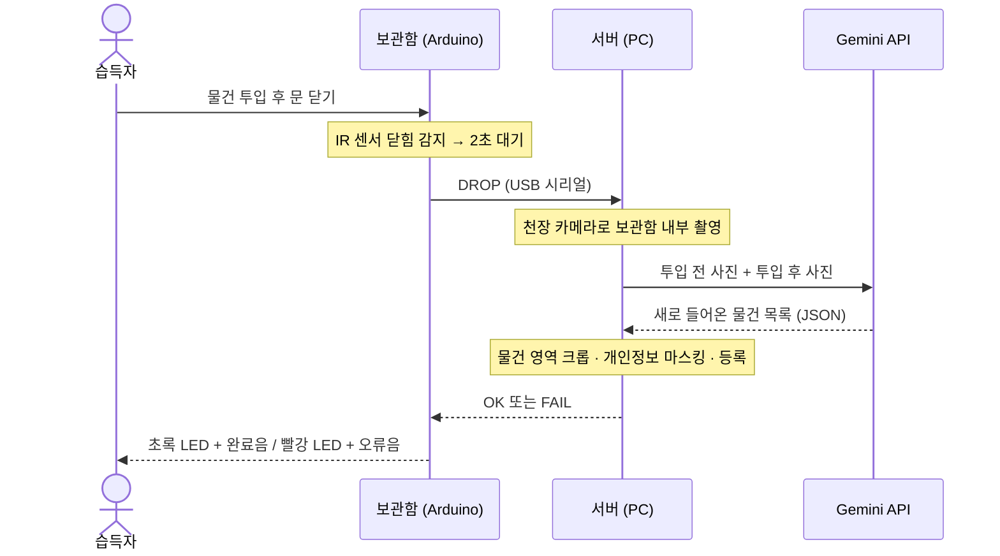
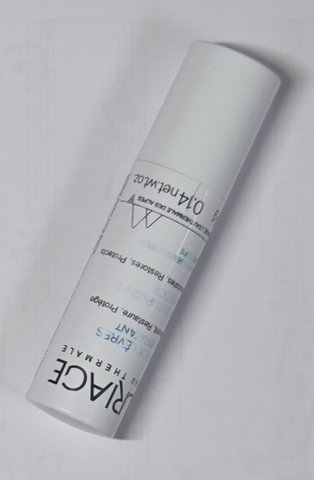
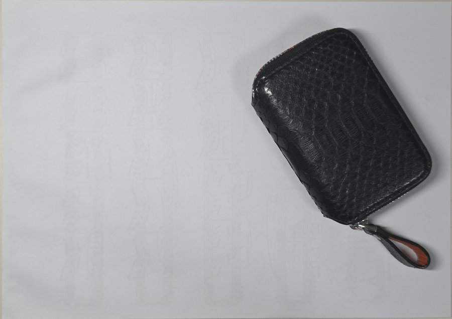
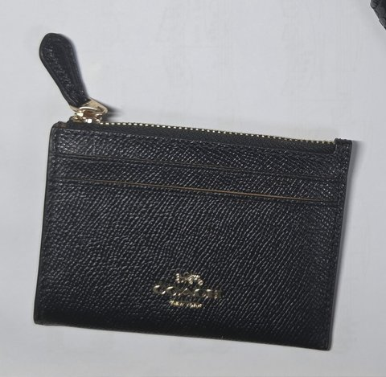
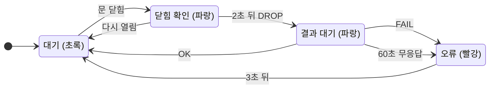

# FindBox — AI 기반 스마트 분실물 보관함

습득물을 보관함에 넣고 문을 닫으면 천장 카메라로 내부를 촬영해 **새로 들어온 물건만** 인식하고 종류·색상·특징을 자동 등록한다.
분실 신고가 들어오면 보관 중인 습득물과 비교해 **매칭 점수와 항목별 판단 근거**를 함께 제공한다.

<p align="center">
  
  
</p>
<p align="center"><sub>캡스톤디자인 전시회 부스. 노트북이 서버와 웹 화면을 담당하고, 보관함 천장에는 웹캠, 상단에는 아두이노가 장착되어 있다.</sub></p>

| 기간                    | 팀 구성                                              | 담당 역할                       | 전시                            |
| ----------------------- | ---------------------------------------------------- | ------------------------------- | ------------------------------- |
| 2026년 9월 ~ 11월 (8주) | 3명 (웹 · 백엔드/DB · AI 각 1명, 하드웨어 공동 제작) | AI (습득물 인식 · 매칭 알고리즘) | 2026년 11월 캡스톤디자인 전시회 |

캡스톤디자인 프로젝트 FindBox 중 **습득물 인식 · 분실물 매칭 · 아두이노 보관함 제어** 코드를 담은 저장소다. 웹 프론트엔드와 백엔드 서버 코드는 포함되어 있지 않다.

`Python` `Gemini API` `OpenCV` `pydantic` `Arduino Uno (C++)`

| 파일                                                         | 역할                                                                                                                                      |
| ------------------------------------------------------------ | ----------------------------------------------------------------------------------------------------------------------------------------- |
| [`findbox_ai.py`](findbox_ai.py)                             | **습득물 인식.** 투입 전·후 이미지를 Gemini API로 비교해 새 물건의 종류·색상·이름·특징·좌표를 추출하고, 영역 크롭 및 개인정보 마스킹을 수행한다 |
| [`findbox_match.py`](findbox_match.py)                       | **분실물 매칭.** 분실 신고와 습득물을 종류·색상·특징·시간 기준으로 비교해 0~100점의 매칭 점수와 항목별 근거를 산출한다                         |
| [`findbox_arduino.ino`](findbox_arduino/findbox_arduino.ino) | **보관함 제어.** IR 센서로 문 닫힘을 감지해 서버에 시리얼 신호를 보내고, 처리 결과를 RGB LED와 부저로 안내한다                                |

설치 방법, 회로 배선, 오류 대처 등은 [사용 설명서](docs/USAGE.md)에 정리되어 있다.

## 동작 흐름



- 아두이노와 서버는 USB 시리얼 통신으로 `DROP`, `OK`, `FAIL` 3개의 명령어만 주고받는다.
- 인식과 매칭은 백엔드 서버에서 바로 호출할 수 있도록 함수 인터페이스(`findbox_ai.analyze()`, `findbox_match.top_found()`, `top_lost()`)로 분리했다.

## 주요 설계

### 1. 투입 전·후 이미지 비교로 신규 물건만 인식

보관함에는 기존 습득물이 그대로 남아 있기 때문에 단일 이미지만 분석하지 않고, 투입 전·후 두 장을 함께 전달해 새로 추가된 물건만 추출하도록 설계했다.

```python
contents = ["사진 1 (넣기 전)", image(before), "사진 2 (넣은 후)", image(after), PROMPT_NEW]
```

- 기존 물건이 밀려 위치가 바뀐 경우나 빠진 물건은 무시하고, 새로 들어온 물건이 없으면 빈 배열을 반환하도록 프롬프트에 명시했다.
- 물건을 **꺼내고** 문을 닫는 상황도 별도 분기 없이 동일하게 처리된다(새 물건 없음 → 미등록).
- 테스트 도구(`findbox_ai.py`)는 새 물건이 인식되었을 때만 기준 이미지를 갱신한다. 인식을 놓치더라도 다음 시도에서 이전 기준 이미지와 다시 비교할 수 있다.
- 전·후 촬영 조건을 일정하게 유지하기 위해 카메라를 열 때마다 자동 초점·노출·화이트밸런스를 끄고 수동 값으로 고정한다. 적용 직후 설정값을 다시 읽어 기대값과 다르면 경고를 출력한다.

테스트 도구(`python findbox_ai.py`) 실행 예시:

```
물건 1개 인식 (3.7초)
[1] 기타 · 검정색 · 검정 절연테이프
    특징: 검정색 롤 테이프이며 안쪽 심지에 3M 로고가 보입니다.
새 물건 없음 (3.0초)
```

[평가](#평가-결과) 당시 책상에서 촬영한 이미지와 실제 인식 결과는 다음과 같다.

| 투입 전                                                                                                           | 투입 후                                                                                        | 인식 결과                                                                                                                                                                                                   |
| ----------------------------------------------------------------------------------------------------------------- | ---------------------------------------------------------------------------------------------- | ----------------------------------------------------------------------------------------------------------------------------------------------------------------------------------------------------------- |
|  |  | <br>`기타 · 흰색 · 유리아쥬 립밤`<br>흰색 원통형 케이스의 립밤으로 'URIAGE' 로고와 파란색 글씨가 인쇄되어 있습니다.            |
|         |     | <br>`지갑 · 검정색 · 코치 검정 카드지갑`<br>상단에 지퍼와 지퍼 손잡이가 있으며 전면에 금색 코치(COACH) 로고가 새겨져 있다. |
|                        |  | `새 물건 없음`<br>기존 물건 3개의 위치만 바꾼 경우                                                                                                                                                           |

### 2. Pydantic 스키마 기반 응답 형식 강제

응답 구조를 Pydantic 모델로 정의하고, 생성한 JSON 스키마를 Gemini API에 넘겨 정해진 형식으로만 응답하도록 제한했다.

```python
class _Item(BaseModel):
    category: Literal[CATEGORIES] = Field(description="물건 종류")
    name: str = Field(description="구체적인 물건 이름")
    color: Literal[COLORS] = Field(description="겉에 보이는 대표 색상")
    features: str = Field(description="주인을 찾는 데 도움이 되는 특징 1~2문장")
    has_personal_info: bool = Field(description="이름·학번·전화번호 같은 개인정보가 보이면 true")
    box_2d: list[int] = Field(description="[ymin, xmin, ymax, xmax], 0~1000으로 정규화한 좌표")
```

- `Literal` 타입이 JSON 스키마의 `enum`으로 변환되므로, 모델은 지정된 목록 안에서만 카테고리와 색상을 선택한다.
- 13개 카테고리와 8개 색상은 인식 가능한 품목을 제한하려는 목록이 아니라 분류 기준이다. 목록에 없는 물건이라도 이름과 특징은 자유롭게 기록하고, 해당하는 카테고리가 없으면 `기타`로 분류한다(위 예시의 절연테이프, 립밤 등).
- 반환된 JSON은 동일한 Pydantic 모델로 한 번 더 검증하며, 형식에 맞지 않으면 파싱 오류로 처리하고 재요청한다.
- 이 목록은 웹 분실물 등록 폼과 동일한 문자열을 사용해, 매칭 단계에서 별도 변환 없이 바로 비교할 수 있다.
- 물건 위치는 `0~1000`으로 정규화된 바운딩 박스(`box_2d`)로 받아, 이미지 크롭과 개인정보 모자이크 영역 계산에 사용한다.

### 3. 다단계 개인정보 보호 처리

학생증이나 카드처럼 개인정보가 노출된 물건이 들어올 수 있어, 모델이 한 번 누락하더라도 정보가 새지 않도록 단계별로 보호 장치를 두었다.

| 단계           | 처리 방식                                                                                                                           |
| -------------- | ----------------------------------------------------------------------------------------------------------------------------------- |
| 프롬프트       | 이름·학번·전화번호·카드번호를 이름과 특징에 기재하지 않도록 지시하고, 개인정보가 보이면 `has_personal_info`를 `true`로 표시          |
| 카테고리 규칙  | 모델 판단과 무관하게 `학생증/카드` 카테고리는 무조건 비공개 처리                                                                    |
| 텍스트 필터링  | 응답에 7자리 이상 숫자가 포함된 경우 정규식으로 `***` 마스킹                                                                        |
| 이미지 마스킹  | 비공개 물건은 원본을 저장하지 않고 모자이크된 크롭 이미지만 반환. 전체 사진에서도 해당 영역을 가리며, 좌표가 비정상이면 전체 모자이크 |
| 매칭 응답 제어 | 비공개 물건은 일반 사용자에게 매칭 점수와 "관리자에게 방문하세요" 안내만 반환하고, 상세 정보는 관리자용 응답에만 포함               |

```python
is_private = item.category in PRIVATE_CATEGORIES or item.has_personal_info
photo = _crop(after, item.box_2d)
if is_private:  # 원본은 어디에도 남기지 않고, 처음부터 모자이크된 사진만 넘긴다
    photo = _mosaic(photo)
```

모자이크는 긴 변 기준 12블록으로 축소한 뒤 최근접 보간(`INTER_NEAREST`)으로 원래 크기로 복원하는 방식이다. 글자는 판독할 수 없고 색상과 대략적인 형태만 남는다.

### 4. 오류 유형 분리 및 타임아웃 설계

| 구분                  | 해당 오류                                                                    | 처리 방식                                                  |
| --------------------- | ---------------------------------------------------------------------------- | ---------------------------------------------------------- |
| 설정 오류 (즉시 중단) | API 키 누락, 잘못된 API 키(400), 잘못된 모델명(404)                          | 재시도 없이 중단하고 설정 수정 후 재실행을 안내            |
| 일시 오류 (재시도)    | 호출 한도 초과(429), 서버 오류(5xx), 20초 타임아웃, 네트워크 오류, 형식 오류 | 1초 대기 후 1회 재요청. 재차 실패하면 다시 시도하도록 안내 |

설정을 고쳐야 해결되는 오류에 불필요하게 재시도를 안내하지 않도록 오류 객체에 `retry` 플래그를 두어 구분했다.

서버와 아두이노 간 타임아웃도 맞췄다. 인식 요청은 최대 `20초 × 2회 + 대기 1초 = 41초` 내에 종료되며, 아두이노는 서버 응답을 60초까지 대기한다.

### 5. 가중치·2-gram 기반 설명 가능한 매칭

분실 신고와 습득물을 항목별로 비교해 0~100점의 매칭 점수를 계산한다. 점수만 표시하면 근거를 파악하기 어렵기 때문에, 항목별 판정(일치·유사·불일치)과 이유 문장을 함께 반환한다.

| 항목 | 가중치 | 비교 방식                                                                               |
| ---- | ------ | --------------------------------------------------------------------------------------- |
| 종류 | 30     | 일치 시 만점. `휴대폰`↔`전자기기` 등 혼동하기 쉬운 쌍이나 둘 다 `기타`인 경우 0.5점 부여 |
| 색상 | 25     | 일치 시 만점. `흰색`↔`회색`처럼 조명에 따라 비슷해 보일 수 있는 쌍은 부분 점수 부여     |
| 특징 | 35     | 분실물의 이름·특징이 습득물 설명에 얼마나 포함되는지 비율로 계산                        |
| 시간 | 10     | 분실 시각 이후 등록 시점이 가까울수록 높은 점수 부여                                    |

- 미입력 항목은 가중치 합계에서 제외해 남은 항목 기준으로 환산한다(분실 시간을 입력하지 않아도 감점되지 않음).
- 종류가 완전히 다르면 다른 항목이 모두 일치해도 최대 25점으로 제한된다. 노출 기준(30점) 미만이라 결과 목록에서 제외된다.
- 분실 시각보다 30분 이상 먼저 등록된 습득물은 동일 물건일 수 없으므로 점수와 관계없이 제외한다.
- 장소 비교 로직(`_compare_place`)도 구현되어 있으나, 단일 부스 시연 환경이라 가중치를 0으로 두었다. 보관함이 여러 건물로 늘어나면 가중치만 올리면 된다.

특징 비교는 외부 형태소 분석기 없이 Python 표준 라이브러리만으로 구현했다.

- 조사를 제거하고(`"스티커가"` → `"스티커"`), 동의어를 통일한 뒤(`airpods` → `에어팟`) 불용어를 제외한다.
- 색상은 색상 항목에서 별도로 비교하므로 특징 텍스트에서 색상 관련 단어를 제거한다.
- 남은 단어를 2-gram(2글자 단위)으로 분리해 분실물 쪽 조각이 습득물 설명에 얼마나 포함되는지 계산한다. 단어 형태가 약간 달라도 겹치도록 했으며, 포함률 80% 이상이면 만점을 준다.
- 단, 조사 `'이'`는 `"곰돌이"` 같은 명사가 훼손되는 문제가 있어 제거 목록에서 제외했다.

`python findbox_match.py` 실행 결과 예시:

```
분실물: 에어팟 프로 (흰색) / 케이스에 곰돌이 스티커가 붙어 있어요 / 13:00 분실

1위 100점 높은 일치 가능성  에어팟 프로 케이스 (흰색, 14:05 등록)
     종류 일치 · 색상 일치 · 특징 일치 · 시간 일치 — '곰돌이', '스티커', '에어팟'이 겹칩니다.
2위  84점 일치 가능성 있음  에어팟 프로 케이스 (흰색, 14:20 등록)
     종류 일치 · 색상 일치 · 특징 유사 · 시간 일치 — '에어팟', '프로'가 겹칩니다.
3위  40점 낮은 일치 가능성  갤럭시 버즈 케이스 (검정색, 14:30 등록)
     종류 일치 · 색상 불일치 · 특징 불일치 · 시간 일치 — 겹치는 특징이 없습니다.
제외  흰색 텀블러 (흰색, 14:40 등록) — 종류가 달라 같은 물건일 가능성이 낮습니다.
제외  에어팟 프로 케이스 (흰색, 11:00 등록) — 분실 시간보다 먼저 들어온 습득물이라 같은 물건일 수 없습니다.
```

### 6. 상태 머신(FSM) 기반 아두이노 펌웨어

보관함 펌웨어는 4가지 상태로 동작하며, 현재 상태가 RGB LED 색상에 대응된다.



- 문 센서 입력에 100ms 디바운싱을 적용해 문이 떨릴 때 중복 감지되지 않도록 했다.
- 문이 닫힌 뒤 2초 대기 후 `DROP`을 전송해 손이 빠지고 물건이 자리 잡을 시간을 확보하며, 대기 중 문이 다시 열리면 취소한다.
- 서버 응답을 기다리는 동안 추가 투입이 발생하면 플래그(`pendingDrop`)에 기록해 두었다가, 현재 처리가 끝난 뒤 이어서 처리한다.
- 서버 응답이 60초 동안 없으면 타임아웃으로 빨간 LED와 긴 경고음을 출력한 뒤 대기 상태로 복귀한다.
- 부저 패턴은 상황별로 다르게 지정했다: 짧은 1회(접수), 짧은 2회(등록 완료), 짧은 3연속(새 물건 없음·실패), 긴 1회(서버 무응답).
- 센서·부저·LED 극성(Active HIGH/LOW, 공통 양극/음극)은 파일 상단 상수 3개로 분리해, 부품 사양이 달라져도 로직 코드를 건드리지 않게 했다.
- 전원이 켜지면 빨강 → 초록 → 파랑 LED 순차 점등 후 부저를 1회 울려 배선 상태를 바로 확인할 수 있다.

## 평가 결과

전시 종료 후 인식과 매칭 성능을 별도로 측정했다. 보관함 대신 책상에 흰 종이를 깔고 물건 15개를 하나씩 놓으며 스마트폰으로 18장을 촬영했고, 보관함과 동일한 `analyze()`를 호출하는 `findbox_photos.py`로 같은 사진 세트를 3회 반복 테스트했다.

|                          | 1회   | 2회   | 3회   |
| ------------------------ | ----- | ----- | ----- |
| 새 물건 판정 (사진 18장) | 18    | 18    | 18    |
| 종류 (물건 15개)         | 15    | 15    | 15    |
| 색상 (물건 15개)         | 15    | 14    | 14    |
| 비공개 처리 (물건 15개)  | 15    | 15    | 15    |
| 평균 소요 시간 (장당)    | 5.2초 | 4.6초 | 4.6초 |

- **새 물건 판정**: 18장 중 15장은 물건을 하나씩 추가한 사진, 3장은 새 물건이 없는 사진(위치 이동, 1개 제거, 전체 제거)이다. 기존 물건을 모두 치우고 새 물건을 놓은 경우에도 신규 물건 1개만 정상 인식했다.
- **색상**: 오답은 가는 금속 테 안경 1건으로, 2·3회차에서 `기타`로 분류되었다.
- **개인정보**: 교통카드는 3회 모두 비공개 처리되어 모자이크된 이미지만 출력되었다.
- **소요 시간**: 총 54회 호출 중 48회가 3~6초 안에 끝났고, 최대 지연은 24.4초였다.

분실 신고 15건을 1회차 인식 결과와 매칭한 결과, 실제 물건이 **1위에 오른 경우가 14건, 상위 3개 안에 포함된 경우가 15건**이었다.

- 1위를 놓친 1건은 검정 지갑 3개 중 하나로, 다른 지갑과 71점 동점이 나왔다. 신고에는 "뱀피 무늬", "손목 끈"으로 적었으나 인식 결과에는 "뱀가죽 패턴", "스트랩"으로 출력되어 문자열이 겹치지 않았다.
- 남색 마우스는 신고(`파란색`)와 인식(`검정색`) 색상이 어긋나 1위는 유지했지만 52점에 그쳤다.

※ **평가 조건의 한계**: 물건 15개를 깔끔한 흰 배경 위에 한 번에 하나씩 놓은 단순한 조건에서 측정한 수치이며, 실제 보관함(천장 웹캠 · 내부 LED 조명) 환경에서 측정한 결과가 아니다.

평가 데이터와 채점 스크립트는 [`docs/eval`](docs/eval)에 있으며, `python docs/eval/score.py`로 동일한 결과를 재현할 수 있다.

## 초기 계획 대비 변경 사항

9월 개발계획서와 최종 구현은 인식 방식과 물건 투입 감지 부분에서 크게 달라졌다.

| 구분      | 초기 계획                                                             | 최종 구현                                                              |
| --------- | --------------------------------------------------------------------- | ---------------------------------------------------------------------- |
| 인식 방식 | 보관함 촬영 데이터로 YOLO 파인튜닝 + OpenCV 대표 색상 추출            | Gemini API로 종류·색상·이름·특징을 한 번에 추출                        |
| 인식 대상 | 학습한 5종 고정 (지갑, 무선 이어폰, 학생증·카드, 휴대폰, 텀블러·물병) | 대상 제한 없이 이름·특징을 기록하고 13개 카테고리로 분류               |
| 투입 감지 | 초음파 센서로 물건 안착 확인 + YOLO 미탐지 시 등록 제외               | 투입 전·후 이미지 비교로 새 물건이 없으면 등록 제외 (초음파 센서 제거) |

**YOLO 대신 Gemini API를 선택한 이유**

- YOLO는 미리 학습한 클래스만 탐지할 수 있어, 어떤 물건이 들어올지 특정하기 어려운 분실물 특성상 한계가 있었다.
- 매칭에서는 스티커·흠집·키링처럼 세부 특징 설명이 핵심인데, YOLO + OpenCV 조합으로는 종류·위치·대표 색상까지만 얻을 수 있었다.
- 초기 계획서에 향후 발전 방향으로 적어 둔 "멀티모달 AI 기반 특징 설명 자동 생성"을 본 구현 단계로 앞당겨 적용했다.

**초음파 센서를 제외한 이유**

- 카드처럼 작고 얇은 물건은 초음파 센서로 안정적으로 감지하기 어려웠다.
- 보관함 바닥에 깐 흰색 폼보드를 물건으로 오감지하는 경우가 있었다.
- 전·후 이미지 비교 방식에서는 얇은 카드도 사진에 찍히고, 폼보드는 투입 전 사진에도 있으므로 물건으로 잡히지 않는다.

## 트러블슈팅

개발 및 실물 테스트 과정에서 발생한 문제와 해결 내용이다.

| 문제 | 원인 | 해결 |
| ---- | ---- | ---- |
|      |      |      |

## 실행 방법

```bash
git clone https://github.com/dyo0o/Findbox-AI-Arduino.git
cd Findbox-AI-Arduino

# 매칭: 별도 패키지 없이 바로 실행 가능 (Python 3.10 이상)
python findbox_match.py

# 인식: Gemini API 키 필요
pip install -r requirements.txt
python findbox_ai.py                 # 웹캠 테스트
```

- `google-genai`는 2.x 버전으로 고정했다. 3.0부터 내부 HTTP 클라이언트가 변경되어 현재 코드의 예외 처리와 호환되지 않는다.
- API 키 설정, 아두이노 배선 및 업로드, 오류별 대처 방법은 [사용 설명서](docs/USAGE.md)에 정리되어 있다.

## 한계 및 개선 방향

- **평가 규모의 한계**: 현재 결과는 물건 15개를 책상에서 촬영한 단순 조건 기준이다. 실제 보관함 환경에서 여러 물건을 동시에 넣거나 물건이 겹친 케이스까지 포함해 추가 검증이 필요하다.
- **문자열 기반 특징 매칭의 한계**: "이어폰"과 "에어팟", "뱀피"와 "뱀가죽"처럼 표현이 다르면 동의어 사전에 등록되지 않은 한 매칭되지 않는다. 향후 문장 임베딩 등 의미 기반 유사도 비교로 보완할 수 있다.
- **외부 API로 원본 이미지 전송**: 개인정보가 포함된 물건도 인식을 위해 Gemini API로 원본 이미지가 전송된다. 현재 마스킹은 인식 이후 저장·공개 단계에서만 적용된다.
- **분류 목록의 분산 관리**: 카테고리·색상 목록이 인식 모듈, 매칭 유사 쌍, 웹 등록 폼 세 곳에 나뉘어 있어 수정 시 수동으로 동기화해야 한다. 단일 설정 파일이나 공유 스키마로 통합할 필요가 있다.

## AI 도구 활용 방식

이 저장소의 코드는 AI 코딩 도구(Claude Code)를 활용해 작성했으며, 변경 사항은 모두 PR을 통해 검토한 뒤 병합했다.

생성된 코드를 그대로 사용하지 않고 실제 하드웨어와 테스트 환경에 맞춰 검증·수정했다. 카메라 수동 설정값은 실제 웹캠 화면을 보며 직접 맞췄고, 부저·LED 극성과 핀 배선 역시 실물 부품으로 동작을 확인하며 조정했다. 
