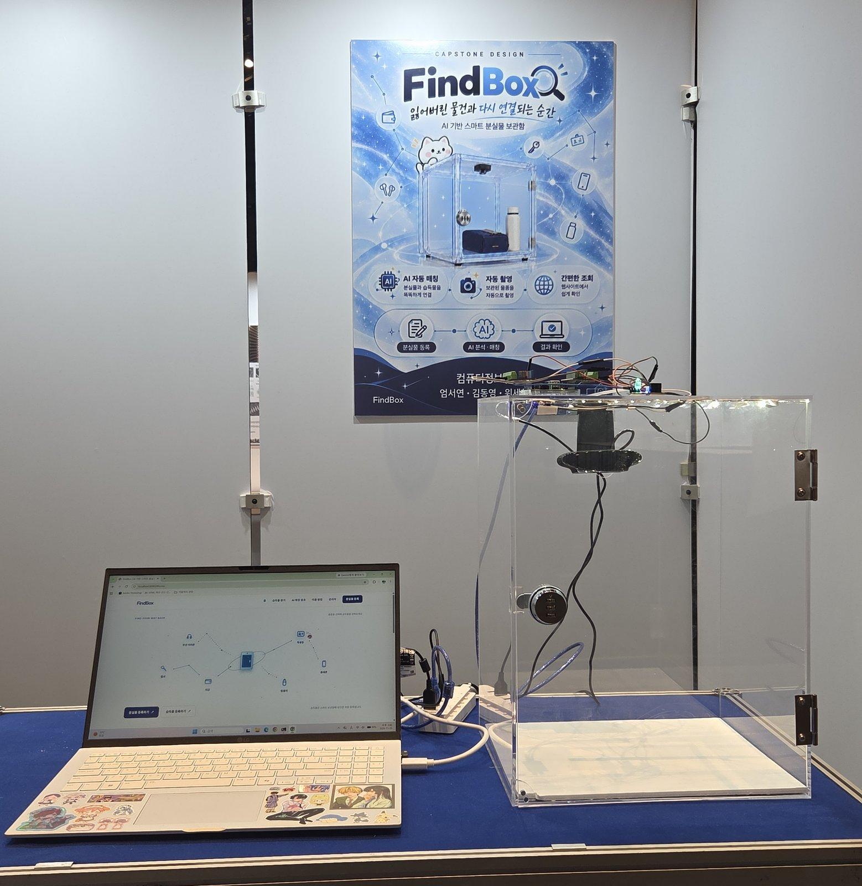
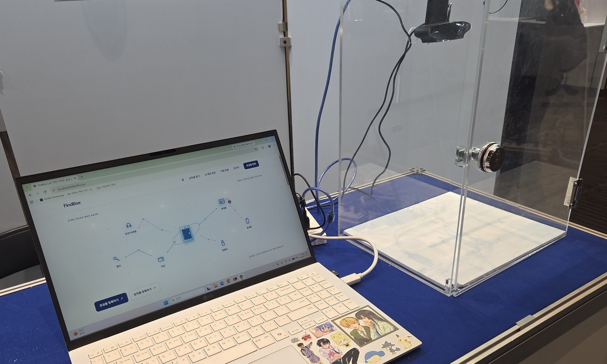
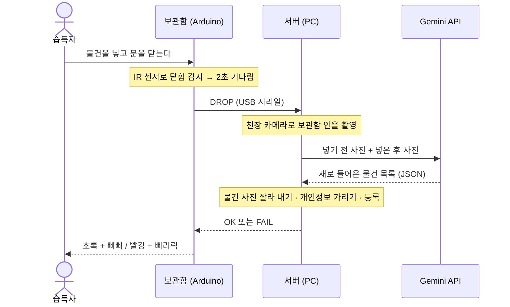
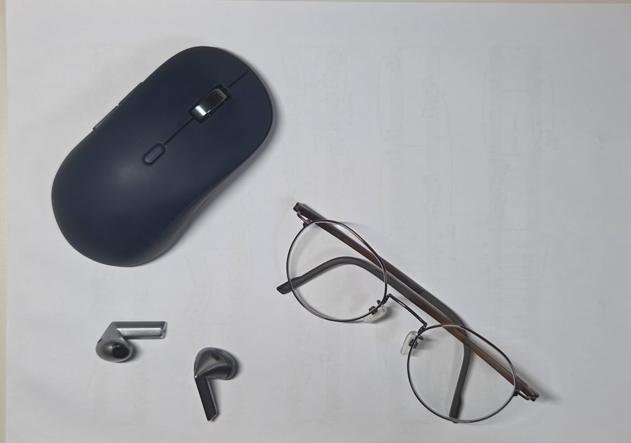
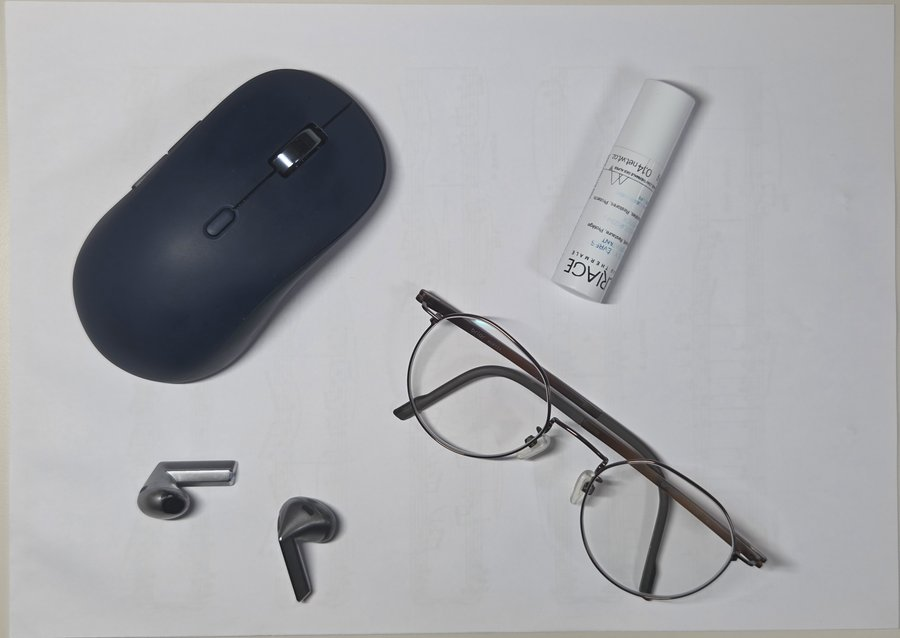
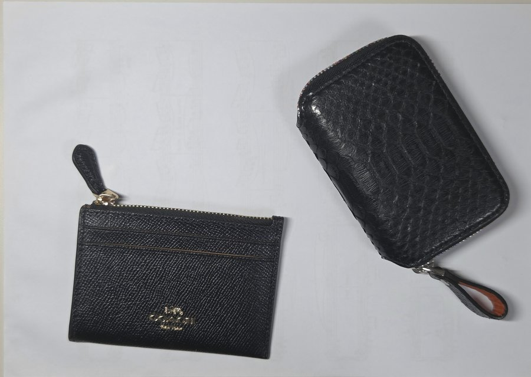
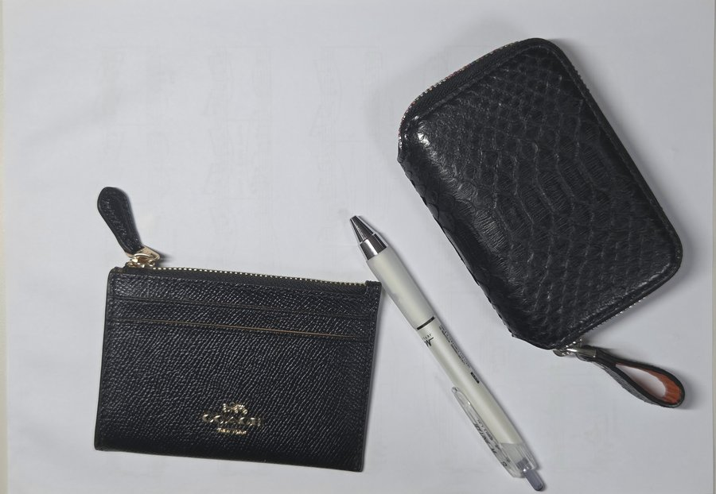
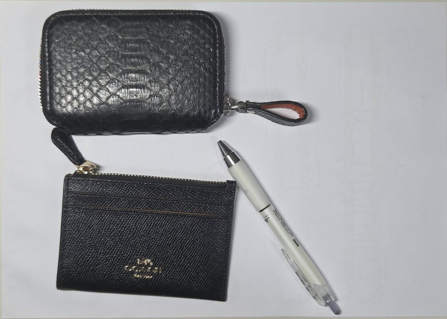
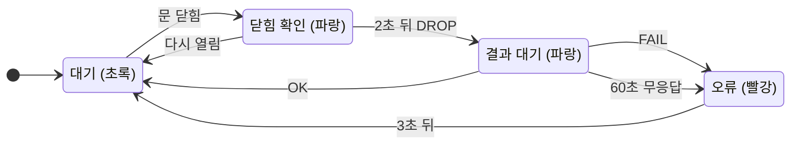

# FindBox — AI 기반 스마트 분실물 보관함

습득물을 보관함에 넣고 문을 닫으면, 보관함이 안을 찍어 **새로 들어온 물건만** 알아보고 종류·색·특징을 기록한다.
분실 신고가 들어오면 습득물과 맞춰 보고 **점수와 그 이유**를 함께 알려 준다.

<p align="center">
  
  
</p>
<p align="center"><sub>캡스톤디자인 전시회 부스. 노트북이 서버와 웹 화면을 맡고, 보관함 천장에는 웹캠이, 위에는 아두이노가 달려 있다.</sub></p>

| 기간                    | 팀                                                                    | 맡은 일                         | 전시                            |
| ----------------------- | --------------------------------------------------------------------- | ------------------------------- | ------------------------------- |
| 2026년 9월 ~ 11월 (8주) | 3명. 웹 페이지, 백엔드·DB, AI를 한 명씩 맡고 하드웨어는 함께 만들었다 | AI: 습득물 인식과 매칭 알고리즘 | 2026년 11월 캡스톤디자인 전시회 |

캡스톤디자인 프로젝트 FindBox 중 **습득물 인식 · 분실물 매칭 · 보관함 제어** 부분의 코드다. 웹 화면과 서버는 이 저장소에 없다.

`Python` `Gemini API` `OpenCV` `pydantic` `Arduino Uno (C++)`

| 파일                                                         | 하는 일                                                                                                                            |
| ------------------------------------------------------------ | ---------------------------------------------------------------------------------------------------------------------------------- |
| [`findbox_ai.py`](findbox_ai.py)                             | **습득물 인식.** 넣기 전·후 사진을 Gemini에 보내 새 물건의 종류·색·이름·특징·위치를 받고, 물건 사진을 잘라 내고, 개인정보를 가린다 |
| [`findbox_match.py`](findbox_match.py)                       | **분실물 매칭.** 분실 신고와 습득물을 종류·색상·특징·시간으로 비교해 0~100점과 항목별 이유를 낸다                                  |
| [`findbox_arduino.ino`](findbox_arduino/findbox_arduino.ino) | **보관함 제어.** 문이 닫힌 것을 감지해 서버에 알리고, 결과를 LED 색과 부저 소리로 알려 준다                                        |

설치·배선·오류 대처는 [사용 설명서](docs/USAGE.md)에 따로 정리했다.

## 동작 흐름



- 보관함과 서버는 USB 시리얼로 `DROP` · `OK` · `FAIL` 세 마디만 주고받는다.
- 인식과 매칭은 서버가 불러 쓰는 함수로 만들었다: `findbox_ai.analyze()`, `findbox_match.top_found()` · `top_lost()`

## 핵심 설계

### 1. 사진 두 장을 비교해 새로 들어온 물건만 찾는다

보관함에는 먼저 들어온 습득물이 남아 있다. 그래서 사진 한 장을 주고 "무엇이 있나"를 묻지 않고, 넣기 전·후 두 장을 같이 주고 "무엇이 새로 생겼나"를 묻는다.

```python
contents = ["사진 1 (넣기 전)", image(before), "사진 2 (넣은 후)", image(after), PROMPT_NEW]
```

- 헷갈릴 만한 경우는 프롬프트에 못 박았다. 원래 있던 물건이 밀린 것은 새 물건이 아니고, 사라진 물건은 무시하며, 새 물건이 없으면 빈 목록을 돌려준다.
- 물건을 **꺼내고** 닫은 경우도 같은 길로 처리된다. 새 물건이 없으니 아무것도 등록되지 않는다.
- 테스트 도구는 새 물건을 찾았을 때만 기준 사진을 바꾼다. 인식이 물건을 놓쳐도 다음 시도에서 다시 비교된다.
- 카메라는 켤 때마다 초점·노출·화이트 밸런스의 자동 기능을 끄고 정해 둔 값으로 고정한다. 그래서 두 사진이 같은 조건으로 찍힌다. 적용된 값을 다시 읽어 보고, 다르면 경고한다.

테스트 도구(`python findbox_ai.py`)로 인식한 결과는 이렇게 나온다.

```
물건 1개 인식 (3.7초)
[1] 기타 · 검정색 · 검정 절연테이프
    특징: 검정색 롤 테이프이며 안쪽 심지에 3M 로고가 보입니다.
새 물건 없음 (3.0초)
```

사진으로 보면 이렇다. 아래는 [평가](#평가-결과) 때 책상에서 찍은 사진과 실제로 나온 결과다.

| 넣기 전                                                                                                           | 넣은 후                                                                                        | 인식 결과                                                                                                                                                                                                   |
| ----------------------------------------------------------------------------------------------------------------- | ---------------------------------------------------------------------------------------------- | ----------------------------------------------------------------------------------------------------------------------------------------------------------------------------------------------------------- |
|  |  | <br>`기타 · 흰색 · 유리아쥬 립밤`<br>흰색 원통형 케이스의 립밤으로 'URIAGE' 로고와 파란색 글씨가 인쇄되어 있습니다.            |
|         |     | <br>`지갑 · 검정색 · 코치 검정 카드지갑`<br>상단에 지퍼와 지퍼 손잡이가 있으며 전면에 금색 코치(COACH) 로고가 새겨져 있다. |
|                        |  | `새 물건 없음`<br>물건 세 개의 자리만 바꾼 사진이다.                                                                                                                                                        |

### 2. 모델의 답을 형식부터 묶는다

답의 형식을 pydantic 모델로 적고, 거기서 뽑은 JSON 스키마를 Gemini에 넘겨 그 형식으로만 답하게 했다.

```python
class _Item(BaseModel):
    category: Literal[CATEGORIES] = Field(description="물건 종류")
    name: str = Field(description="구체적인 물건 이름")
    color: Literal[COLORS] = Field(description="겉에 보이는 대표 색상")
    features: str = Field(description="주인을 찾는 데 도움이 되는 특징 1~2문장")
    has_personal_info: bool = Field(description="이름·학번·전화번호 같은 개인정보가 보이면 true")
    box_2d: list[int] = Field(description="[ymin, xmin, ymax, xmax], 0~1000으로 정규화한 좌표")
```

- `Literal`로 적은 목록이 스키마의 `enum`이 된다. 종류와 색상은 이 목록 안에서만 고른다.
- 종류 13개와 색상 8개는 알아볼 수 있는 물건의 범위가 아니라 분류 칸이다. 인식 대상은 정해 두지 않았다. 무슨 물건이든 이름과 특징을 문장으로 적고, 맞는 칸이 없거나 애매하면 `기타`에 넣는다. 위 예시의 절연테이프와 립밤이 그런 경우다.
- 돌아온 답은 같은 모델로 한 번 더 검증한다. 어긋나면 형식 오류로 보고 다시 요청한다.
- 이 목록은 웹의 분실물 등록 폼과 같은 값이다. 사람이 고른 종류와 AI가 고른 종류가 같은 글자라서 매칭에서 그대로 비교할 수 있다.
- 위치는 0~1000으로 정규화한 상자로 받는다. 이 상자로 물건 사진을 잘라 내고 가릴 자리를 정한다.

### 3. 개인정보는 한 겹에 맡기지 않는다

학생증이나 카드가 들어올 수 있다. 모델이 한 번 실수해도 새지 않도록 여러 겹으로 막았다.

| 단계     | 방법                                                                                                                          |
| -------- | ----------------------------------------------------------------------------------------------------------------------------- |
| 프롬프트 | 이름·학번·전화번호·카드번호를 물건 이름과 특징에 쓰지 못하게 하고, 개인정보가 보이면 따로 표시하게 한다                       |
| 규칙     | 모델의 판단과 상관없이 `학생증/카드` 종류는 항상 비공개로 처리한다                                                            |
| 글자     | 그래도 모델이 적어 버린 7자리 이상의 숫자는 정규식으로 `***`로 바꾼다                                                         |
| 사진     | 비공개 물건은 처음부터 모자이크한 사진만 돌려준다. 보관함 전체 사진에서도 그 자리를 가리고, 자리를 알 수 없으면 전체를 가린다 |
| 매칭     | 비공개 물건은 점수와 "관리자에게 방문하세요" 안내만 내보낸다. 자세한 내용은 관리자용 결과에만 있다                            |

```python
is_private = item.category in PRIVATE_CATEGORIES or item.has_personal_info
photo = _crop(after, item.box_2d)
if is_private:  # 원본은 어디에도 남기지 않고, 처음부터 모자이크된 사진만 넘긴다
    photo = _mosaic(photo)
```

모자이크는 긴 변을 12칸으로 줄였다가 다시 키우는 방식이다. 글자는 읽을 수 없고 색과 대략적인 모양만 남는다.

### 4. 실패를 두 종류로 나눈다

|              | 해당하는 오류                                                              | 처리                                                                          |
| ------------ | -------------------------------------------------------------------------- | ----------------------------------------------------------------------------- |
| 고쳐야 함    | API 키가 없음, API 키가 틀림(400), 모델 이름이 틀림(404)                   | 바로 멈추고 "고친 뒤 프로그램을 다시 켜세요"라고 알린다                       |
| 다시 하면 됨 | 사용량 한도(429), 서버 오류(5xx), 20초 무응답, 인터넷 끊김, 형식이 틀린 답 | 1초 쉬고 한 번 더 요청한다. 그래도 안 되면 "다시 Space를 누르세요"라고 알린다 |

다시 해도 똑같이 실패할 오류에 "다시 해 보세요"라고 안내하지 않으려고 나눴다.

시간도 서로 맞췄다. 인식은 길어야 20초 × 2번 + 1초 = 41초이고, 보관함은 서버의 답을 60초까지 기다린다.

### 5. 점수와 이유를 함께 내는 매칭

분실 신고 하나와 습득물 하나를 항목별로 비교해 0~100점을 낸다. 점수만 보여 주면 믿기 어려우므로, 항목마다 일치·유사·불일치 판정과 이유 문장을 같이 만든다.

| 항목 | 비중 | 비교 방법                                                                                                      |
| ---- | ---- | -------------------------------------------------------------------------------------------------------------- |
| 종류 | 30   | 같으면 일치. 휴대폰↔전자기기처럼 헷갈리기 쉬운 짝은 절반. 둘 다 `기타`일 때도 절반만 주고 이름·특징으로 가린다 |
| 색상 | 25   | 같으면 일치. 흰색↔회색처럼 조명에 따라 비슷해 보이는 짝은 부분 점수                                            |
| 특징 | 35   | 분실물의 이름·특징이 습득물 설명에 얼마나 들어 있는지                                                          |
| 시간 | 10   | 분실 후 빨리 등록될수록 높다                                                                                   |

- 적지 않은 항목은 빼고 남은 비중으로 환산한다. 분실 시간을 모른다고 점수가 깎이지 않는다.
- 종류가 확실히 다르면 나머지가 다 맞아도 25점을 넘지 못한다. 표시 기준인 30점보다 낮아서 결과에 나오지 않는다.
- 분실 시간보다 30분 넘게 먼저 들어온 습득물은 같은 물건일 수 없으므로 점수와 상관없이 뺀다.
- 장소를 비교하는 코드도 있지만 비중은 0이다. 시연에서는 보관함이 학교 부스 한 곳에 고정이라 비교할 것이 없었다. 보관함이 여러 건물에 놓이면 비중만 올리면 된다.

특징은 형태소 분석기 없이 파이썬 표준 라이브러리만으로 비교한다.

- 조사를 떼고("스티커가" → "스티커"), 같은 뜻의 말을 하나로 맞추고(airpods → 에어팟), "있어요" 같은 흔한 말을 뺀다.
- 색상 단어도 뺀다. 색은 색상 항목에서 이미 비교하기 때문이다.
- 남은 단어를 두 글자 조각으로 잘라, 분실물 쪽 조각이 습득물 설명에 얼마나 들어 있는지 본다. 단어 모양이 조금 달라도 겹치고, 80% 이상 들어 있으면 만점이다.
- 조사 '이'는 일부러 떼지 않는다. "곰돌이"가 "곰돌"이 되기 때문이다.

`python findbox_match.py`를 실행하면 예시 데이터로 결과를 볼 수 있다.

```
분실물: 에어팟 프로 (흰색) / 케이스에 곰돌이 스티커가 붙어 있어요 / 13:00 분실

1위 100점 높은 일치 가능성  에어팟 프로 케이스 (흰색, 14:05 등록)
     종류 일치 · 색상 일치 · 특징 일치 · 시간 일치 — '곰돌이', '스티커', '에어팟'이 겹칩니다.
2위  84점 일치 가능성 있음  에어팟 프로 케이스 (흰색, 14:20 등록)
     종류 일치 · 색상 일치 · 특징 유사 · 시간 일치 — '에어팟', '프로'가 겹칩니다.
3위  40점 낮은 일치 가능성  갤럭시 버즈 케이스 (검정색, 14:30 등록)
     종류 일치 · 색상 불일치 · 특징 불일치 · 시간 일치 — 겹치는 특징이 없습니다.
제외  흰색 텀블러 (흰색, 14:40 등록) — 종류가 달라 같은 물건일 가능성이 낮습니다.
제외  에어팟 프로 케이스 (흰색, 11:00 등록) — 분실 시간보다 먼저 들어온 습득물이라 같은 물건일 수 없습니다.
```

### 6. 어떤 경우에도 대기로 돌아오는 펌웨어

보관함은 네 가지 상태를 오간다. LED 색이 곧 상태다.



- 문 신호는 100ms 동안 그대로일 때만 바뀐 것으로 본다. 문이 떨려도 여러 번 닫힌 것으로 세지 않는다.
- 닫히고 2초 뒤에 `DROP`을 보낸다. 손이 빠지고 물건이 자리를 잡는 시간이다. 그 사이 다시 열리면 취소한다.
- 결과를 기다리는 동안 또 넣고 닫으면 기억해 두었다가, 결과가 나온 뒤 이어서 처리한다.
- 서버가 60초 동안 답이 없으면 스스로 빠져나와 빨강과 긴 소리로 알린다. 서버가 죽어도 보관함이 파랑에 갇히지 않는다.
- 소리 하나에 뜻 하나만 붙였다. 삑(접수), 삐삐(등록), 삐리릭(새 물건 없음·실패), 삐―(서버 무응답).
- 센서·부저·LED의 극성은 파일 맨 위 상수 세 개로 바꾼다. 부품이 달라져도 동작 코드는 건드리지 않는다.
- 전원이 들어오면 빨강 → 초록 → 파랑 → 삑 순서로 켠다. 배선이 맞는지 눈과 귀로 바로 확인할 수 있다.

## 평가 결과

전시가 끝난 뒤 인식과 매칭이 얼마나 맞는지 다시 재 보았다. 보관함 대신 책상에 흰 종이를 깔고 물건 15개를 하나씩 놓으며 휴대폰으로 18장을 찍었고, 그 사진을 `findbox_photos.py`로 인식했다. 보관함에서 쓰는 것과 같은 `analyze()`를 거친다. 같은 사진으로 세 번 돌렸다.

|                          | 1회   | 2회   | 3회   |
| ------------------------ | ----- | ----- | ----- |
| 새 물건 판정 (사진 18장) | 18    | 18    | 18    |
| 종류 (물건 15개)         | 15    | 15    | 15    |
| 색상 (물건 15개)         | 15    | 14    | 14    |
| 비공개 처리 (물건 15개)  | 15    | 15    | 15    |
| 한 장에 걸린 시간 (평균) | 5.2초 | 4.6초 | 4.6초 |

- **새 물건 판정**: 18장 중 15장은 물건을 하나씩 더한 사진이고, 3장은 새 물건이 없어야 하는 사진(자리만 바꿈, 하나를 뺌, 전부 치움)이다. 앞의 물건을 모두 치우고 다른 물건을 놓은 경우에도 새 물건 하나만 찾았다.
- **색상**: 틀린 것은 가는 금속 테 안경으로, 두 번 `기타`라고 답했다.
- **개인정보**: 교통카드는 세 번 모두 비공개로 처리되어 모자이크된 사진만 나왔다.
- **시간**: 54번 가운데 48번이 3~6초였고, 가장 오래 걸린 한 번은 24초였다.

분실 신고 15건을 1회 인식 결과와 매칭해 보면, 진짜 물건이 **1위인 것이 14건, 매칭 함수가 돌려주는 상위 3개 안에 든 것이 15건**이다.

- 1위를 놓친 한 건은 검정 지갑 세 개 중 하나로, 다른 지갑과 71점 동점이었다. 신고에는 "뱀피 무늬", "손목 끈"이라고 썼는데 인식 결과에는 "뱀가죽 패턴", "스트랩"이라고 적혀 글자가 겹치지 않았다.
- 남색 마우스는 신고가 `파란색`, 인식이 `검정색`이어서 1위이긴 했지만 52점에 그쳤다.

이 숫자를 읽을 때 알아 둘 점이 있다.

- 물건 15개, 깨끗한 흰 배경, 한 번에 하나씩 넣은 쉬운 조건이다. 보관함 안(천장 카메라, LED 조명)에서 잰 것이 아니다.

자료와 채점 스크립트는 [`docs/eval`](docs/eval)에 있다. `python docs/eval/score.py`로 같은 숫자를 다시 볼 수 있다.

## 처음 계획에서 달라진 것

9월에 세운 계획과 최종 구현은 인식 부분이 크게 다르다.

|         | 처음 계획                                                                           | 최종 구현                                                                                          |
| ------- | ----------------------------------------------------------------------------------- | -------------------------------------------------------------------------------------------------- |
| 방법    | 보관함에서 직접 찍은 사진으로 YOLO를 학습하고, OpenCV로 대표 색상을 뽑는다          | Gemini에 사진을 보내 종류·색·이름·특징을 한 번에 받는다                                            |
| 대상    | 학습한 5종 (지갑, 무선 이어폰, 학생증·카드, 휴대폰, 텀블러·물병)                    | 정해 두지 않았다. 무슨 물건이든 이름과 특징을 적고, 13개 분류 중 하나로 정리한다 |
| 새 물건 | 초음파 센서로 물건이 놓였는지 확인하고, YOLO가 아무것도 찾지 못하면 등록하지 않는다 | 넣기 전·후 사진을 비교해 새 물건이 없으면 등록하지 않는다. 초음파 센서는 뺐다                      |

**YOLO 학습 대신 Gemini를 쓴 이유**

- YOLO는 학습한 종류만 찾는 방식이다. 분실물은 무엇이 들어올지 미리 정할 수 없어서 맞지 않다고 판단했다.
- 관건은 특징 설명이었다. 스티커, 흠집, 키링처럼 주인을 가려 줄 특징을 문장으로 받아야 하는데, 계획한 방식으로 얻는 것은 종류와 위치, 대표 색상까지다.
- 계획서에는 "멀티모달 AI로 특징 설명 자동 생성"이 향후 발전 방향으로 적혀 있었다. 그것을 앞당겨 넣은 셈이다.

**초음파 센서를 뺀 이유**

- 카드처럼 작고 얇은 물건은 잘 감지하지 못했다.
- 보관함 바닥에 깐 흰 폼보드를 물건으로 감지하는 경우가 있었다.
- 사진을 비교하는 방식에서는 얇은 카드도 사진에 찍히고, 폼보드는 넣기 전 사진에도 있으므로 물건으로 세지 않는다.

## 만들면서 고친 것

만드는 동안 나온 문제와 고친 방법이다. 과정은 커밋에 남아 있다.

| 문제                                                        | 원인                                                                                                  | 고친 방법                                                                                                                                                            |
| ----------------------------------------------------------- | ----------------------------------------------------------------------------------------------------- | -------------------------------------------------------------------------------------------------------------------------------------------------------------------- |

## 직접 돌려 보기

```bash
git clone https://github.com/dyo0o/Findbox-AI-Arduino.git
cd Findbox-AI-Arduino

# 매칭: 설치할 것 없이 바로 실행된다 (Python 3.10 이상)
python findbox_match.py

# 인식: Gemini API 키가 필요하다
pip install -r requirements.txt
python findbox_ai.py                 # 웹캠으로
```

- `google-genai`는 2.x로 고정했다. 3.0부터 통신 라이브러리가 바뀌어 이 코드의 오류 처리와 맞지 않는다.
- API 키 설정, 아두이노 배선과 업로드, 오류 메시지별 해결은 [사용 설명서](docs/USAGE.md)에 있다.

## 한계와 다음 단계

- **평가가 작고 쉬운 조건이다.** 위 결과는 물건 15개를 책상에서 찍은 사진으로 잰 것이다. 보관함 안에서, 여러 개를 한꺼번에 넣거나 물건이 겹친 경우까지 넣어 더 많이 재야 한다.
- **특징 비교는 글자가 겹쳐야 한다.** "이어폰"과 "에어팟"처럼 표현이 다르면 동의어 표에 없는 한 놓친다. 평가에서도 "뱀피"와 "뱀가죽"이 그렇게 어긋났다. 뜻으로 비교하는 방법(문장 임베딩 등)을 붙일 수 있다.
- **원본 사진은 Gemini로 전송된다.** 개인정보가 보이는 물건도 인식하려면 원본을 보내야 한다. 가리는 것은 그 뒤의 저장·공개 단계다.
- **종류·색상 목록이 세 군데에 있다.** 인식 모듈, 매칭의 유사 짝, 웹 등록 폼을 손으로 맞춰야 한다. 이름 하나를 바꾸면 세 곳을 같이 바꿔야 한다.


## AI와 함께 만든 방식

이 저장소의 코드는 AI 코딩 도구(Claude Code)와 함께 작성했고, 그 과정이 커밋 기록에 그대로 남아 있다. 변경은 모두 PR(#1~#9)로 올려 합쳤다.

AI가 쓴 코드를 그대로 두지 않고 실물에 맞춰 고쳐 나갔다. 카메라 값은 설정 창에서 실제 웹캠을 보며 맞춘 값이고, 부저와 LED의 극성은 실제 부품에 맞춰 확인했으며, LED 핀 배선은 문을 닫아 보고 확인했다. 팀원이 고친 아두이노 스케치와 합친 변경도 있다. 그 과정에서 나온 문제와 고친 방법은 위 표에 적었다.
